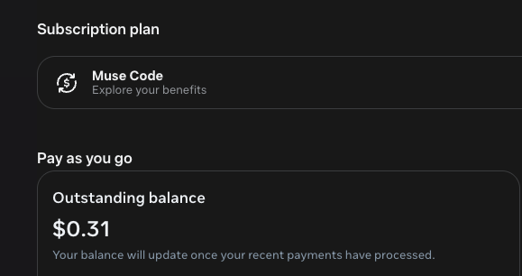

# FridgeGraph provenance

## Origin and build window

Tori, a single-mother friend, sent Bryan the August 11 message reproduced in full in the [README](README.md). It is the human origin of the idea, not a pre-existing application. Bryan began the FridgeGraph application from scratch at the start of this hackathon on October 26, 2026, drawing on his years of enterprise infrastructure experience. The application code, schemas, fixtures and documentation in this repository were written for the Meta Global AI Developer Hackathon beginning October 26, 2026; no application code was copied from a pre-existing private repository. The showcase families and children are fictional.

The original screenshot is committed as `docs/assets/origin/tori-message-original.jpg` with its full 1312 × 2048 composition, no crop or retouch. Its SHA-256 before upload was `10a23f6fdfdcaba12f4897b68e7c17282ca1efc6f319dcc0c9004f2250ad9afa`.

The current Nora demo portrait was supplied by Bryan and is preserved without alteration at `docs/assets/readme/nora-current.png` (384 × 384). Its original Git blob hash is `b592188d90d3de79c4f41345165dafe569ef27e5`. Historical test captures may contain a retired portrait and remain unchanged as evidence. No model authorship is inferred from the supplied image.

## What is produced by which model

| Source | Role | Boundary |
| --- | --- | --- |
| Muse Spark 1.3 | Rosina's grounded conversation, notice interpretation and action proposals. | A parent confirms; server and database permissions decide what can be read and saved. |
| Muse Voice Transcribe 1.0 | Speech-to-text in the original sequential Rosina voice path; distinct from the newer Retell transport. | It does not authorize actions. |
| Muse Image 1.0 | Creative invitation artwork, reference edits and revisions. | The app renders exact names, times and places as text; provider receipts and served-build checks must be distinguished. |
| Muse Wonder | Development research, diagnosis, review and test assistance. | It is not the runtime reasoner. Its reports require independent checks against source and the served build. |
| ElevenLabs | Rosina's speech and replay narration. | Separate from Meta transcription and reasoning. |
| Retell | Browser web-call transport merged in PR #293, following the isolated #280 work. | Bryan reports successful public voice and parent-confirmed calendar creation. No new live test was performed for this documentation update; do not generalize to all action types. |

Apollo GraphQL infrastructure (Apollo Federation, Apollo Router, Rover and Apollo MCP Server), the Apollo GraphOS platform, Supabase, Vite, React and the other libraries are external infrastructure and dependencies, not code authored for this project. n8n and GoHighLevel workflows were configured for FridgeGraph. On November 5, Bryan confirmed that the SMS and call integrations work, and clarified that live outreach is deliberately suppressed during testing to avoid contacting his integrated real contacts. This is owner-reported operational confirmation, not a new provider test performed by this documentation update. Existing receipts retain their original scope; no real contact details are published here. The shipped fictional portrait sets have their own provenance files under `web/src/assets/portraits/` and `web/public/fridge/`; do not describe all artwork as Muse-generated.

## Before → decision → recorded result

The old situation is fragmented information and a parent manually relaying it. A working demonstrated path is: a sample school notice comes in → Muse Spark identifies a conflict with the authorized schedule → Rosina presents a proposed pickup request → the parent confirms → a stored job ID appears in Rosina, Today and Mission Control. The proposal is not a pickup, and a request is not a completed pickup. Calendar actions follow a similar explicit confirm and audit trail. See [notice evidence](docs/evidence/67-rosina-notice-briefing-live.md), [browser proof](web/evidence/notice-plan/live-2026-11-02/RECEIPT.md), and the later [mouse-confirm repair](https://github.com/Pettybytes/fridgegraph/pull/282).

For safety and honesty, distinguish **implemented**, **merged**, **deployed**, and **verified on the served build**. CI checks source; public-site actions and provider receipts establish narrower live claims. Orbit preview is part of the current judge path; a full activation and SMS dispatch are not asserted as freshly verified on that path. The historical voice speed limitation, merged Retell transport and owner-reported voice result are documented separately in the README.

## Muse account snapshot

Bryan supplied this unaltered screenshot on November 4, 2026, as supporting context for his use of Muse during the build. It shows a **Muse Code** subscription and a **$0.31 outstanding pay-as-you-go balance**, with a notice that the balance updates after recent payments are processed.

This is an account snapshot, not a usage ledger: it does not establish total spend, exhausted promotional credits, token counts, a model-by-model breakdown, or how much usage belongs to FridgeGraph. The model roles and linked execution receipts above provide the project-specific evidence.

Original file SHA-256: `1e75f8f296b06b359c16035db7d7381f9eae2e7a080843e26c34b10e435a74aa`.

## Identity

Supabase Auth issues JWTs. `jose` (MIT) verifies signatures locally; it mints nothing. Demo credentials and the server-side identity map are gitignored, never committed, and must remain outside this repository. No token, key, or signing material is intended to be stored here.
