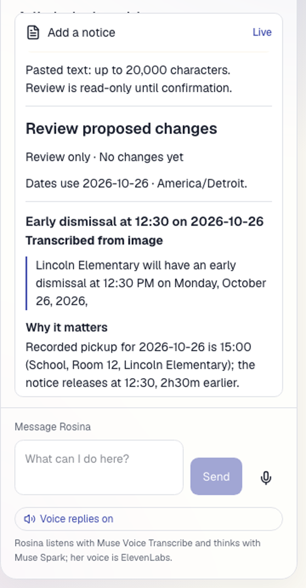
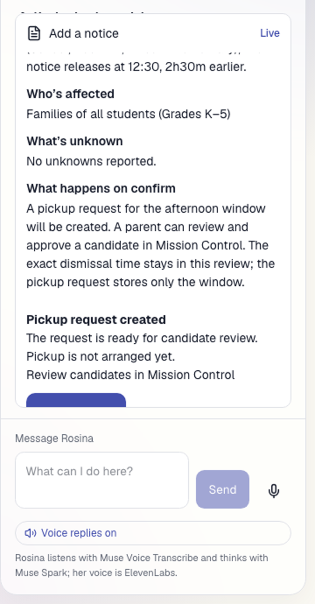
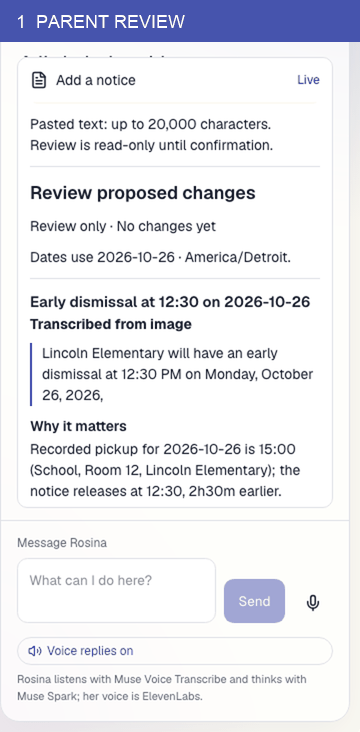
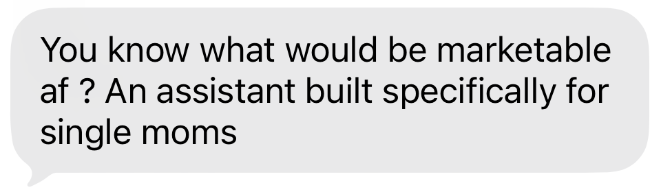
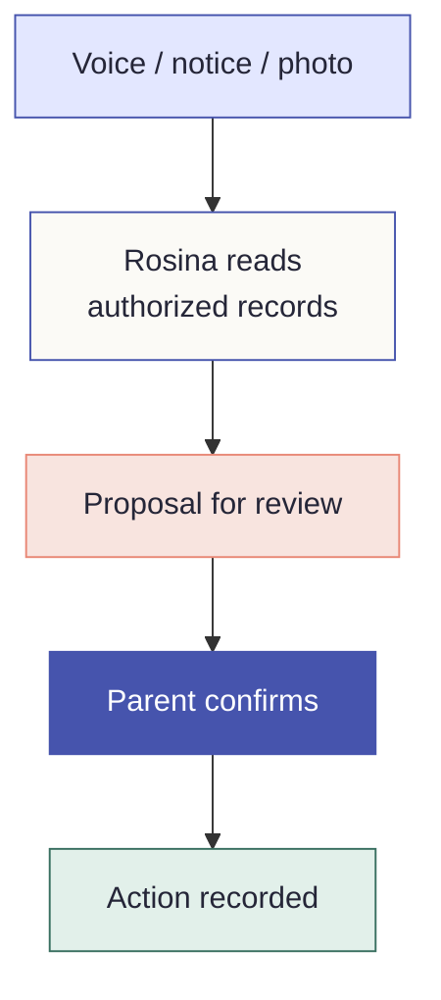

<picture>
  <source media="(prefers-color-scheme: dark)" srcset="docs/assets/readme/hero-dark.svg">
  
</picture>

**School changes. Caregivers coordinate. Parents stay in control.**

**Powered by Meta Muse** · Muse Spark 1.3 · Muse Voice Transcribe 1.0

<a href="#explore-the-demo"></a>
<a href="#see-it-work"></a>
<a href="#meet-rosina"></a>
<a href="#architecture"></a>
<a href="#evidence-index"></a>

Live sandbox coming soon <!-- LIVE LINK: set at hosting --> · [Static hero](docs/assets/readme/hero-static.svg)

<a id="meet-rosina"></a>
## Meta Muse: three roles, two models

| Meta Muse in the family |
| --- |
| <br>A school notice becomes structured changes and a proposed plan. Verified pasted text can be quoted; image/PDF text is a transcription.<br>**Observed:** [Sample notice conflict and reviewed request](docs/evidence/67-rosina-notice-briefing-live.md); [browser proof](web/evidence/notice-plan/live-2026-11-02/RECEIPT.md). |
| <br>A parent can review photo descriptors drawn from the child's **55 allowed vocabulary values**.<br>**Observed:** [Three descriptor kinds proposed from the fictional test photo](docs/evidence/64-photo-descriptor-authority.md); [refusal and zero-call checks](docs/evidence/63-photo-descriptor-authority.md). |
| <br>Spoken input becomes text for Rosina's conversation.<br>**Observed:** [Corrected backend round trip](docs/evidence/61b-voice-backend-corrected.md); [separate mounted playback proof](web/evidence/design/run-voice-roundtrip/RECEIPT.md). |

Muse Spark also powers Rosina's conversation and tool use. ElevenLabs generates reply speech; it is separate from Meta transcription.

<a id="see-it-work"></a>
## See it work

**School notice → parent review → recorded pickup request.** Kendra used a published sample early-dismissal image. Rosina transcribed its change, compared it with the recorded pickup time, and prepared a request. The reviewed proposal specified `requestPickup` for the afternoon window. Kendra confirmed once; the resulting job was **discovering**, with pickup **not arranged yet**.

<a href="web/evidence/notice-plan/live-2026-11-02/sample-a-review-desktop.png"></a>
<a href="web/evidence/notice-plan/live-2026-11-02/sample-a-result-desktop.png"></a>

<details><summary>Replay the two recorded browser frames</summary>



</details>

*Source: committed Kendra browser captures of live sample-(a) preparation and one authenticated confirmation. The replay only alternates those captured states; it is not a new live call. [Full receipt and served revisions](web/evidence/notice-plan/live-2026-11-02/RECEIPT.md).*

## Why I built it

A single-mother friend sent me a text: “An assistant built specifically for single moms.”



*Her message, shared with permission. The publication crop contains only her words.*

I build systems that help teams coordinate across people, services and responsibilities. Her message made me see the same problem at home: parents carrying the connections in their heads, stitching together school messages, calendars and conversations.

At home, the family fridge becomes the shared interface: calendars, notes and magnets. The parent still connects everything behind it.

Help can exist all around a child. Coordinating that help is another job.

FridgeGraph brings those connections into one permissioned view. Rosina reads notices, prepares plans and helps caregivers coordinate. Parents decide what happens, who joins and what each person can see.

In the future, the village could grow with the family: agents suggesting useful connections, while people decide whom to trust and what to share.

The goal is simple: help the village handle the logistics so parents can be present.

The sandbox uses fictional people and records. The origin message is real, shared with permission and identifying details removed.

## Three demonstrations

1. **A school notice changes the plan.** Rosina finds the conflict with the recorded schedule and prepares a request for parent review. The [live notice proof](docs/evidence/67-rosina-notice-briefing-live.md) and [browser receipt](web/evidence/notice-plan/live-2026-11-02/RECEIPT.md) show the separate confirmation.
2. **The village grows, with permission.** A parent reviews Dana's exact access and confirms a bounded `pickup.request` grant. The [latest proof correction](docs/evidence/72-add-villager-live.md#superseding-correction-append-only--the-third-slots-pass-record-above-is-kept-not-rewritten) leaves Dana's own discovery and real concurrent confirms unproven.
3. **Orbit brings the village together.** A parent approves activation, caregivers can report what they know, and the parent closes the alert. A caregiver response supports coordination; it does not independently verify safety. The [Orbit proof](docs/evidence/60-orbit-redesign.md) and [post-close redaction proof](docs/evidence/62-orbit-redaction.md) keep those states separate.

## From understanding to action

The diagram shows the family workflow, not a live event stream. Rosina can store a draft or proposal before confirmation; the consequential pickup request is a separate parent action.



Meta interprets or transcribes the input. Rosina reads only what the signed-in caller may see. A parent reviews the proposal and explicitly confirms. Deterministic services apply policy and record the action; a caregiver's response is still a report, not verified presence.

## Observed results

| Model role | Observed result | Evidence |
| --- | --- | --- |
| Muse Spark · notice and conversation | Sample-(a) conflict identified against a recorded pickup time; parent reviewed and made one separate request, then the job was **discovering**. | [67](docs/evidence/67-rosina-notice-briefing-live.md), [browser receipt](web/evidence/notice-plan/live-2026-11-02/RECEIPT.md) |
| Muse Spark vision | Three of five descriptor kinds proposed from a fictional photo; unauthorized paths made zero model calls. | [63](docs/evidence/63-photo-descriptor-authority.md), [64](docs/evidence/64-photo-descriptor-authority.md) |
| Muse Voice Transcribe | Corrected backend speech-to-text round trip; mounted reply playback proved separately using injected fixture audio. | [61b](docs/evidence/61b-voice-backend-corrected.md), [UI receipt](web/evidence/design/run-voice-roundtrip/RECEIPT.md) |
| Deterministic access policy, not a model decision | Kendra's exact Dana grant and refusals were recorded. Dana's own discovery and live concurrent confirms remain unproven. | [72 and its correction](docs/evidence/72-add-villager-live.md#superseding-correction-append-only--the-third-slots-pass-record-above-is-kept-not-rewritten) |

Evidence numbers are record identifiers, not a total of independent passed tests. The full boundaries are in the [capability matrix](#what-is-working-and-what-remains-open).

## How it's built

<a id="architecture"></a>
### Architecture

Rosina uses Muse Spark for conversation, notice reading and photo suggestions. Its authorized tool path carries the signed-in person's token through Apollo MCP Server to Apollo Router and seven domain subgraphs over Supabase Postgres RLS. Features also have direct authenticated API paths where implemented. The notice and Add a Villager confirmations use separate authenticated UI/server operations; neither confirmation sits in the model's tool lane. Draft/proposal storage may happen before that consequential action. Services and database policies enforce what the caller may read or change.

GHL and n8n carry calls, texts, callbacks and dispatch in the evidenced workflow. Real outbound outreach is disabled for the judges' path. The [topology](#router-topology-main--tested-rollback), [subgraph ownership](#the-seven-subgraphs-and-what-each-owns) and [security boundary](#security) are detailed below.

**Find the local setup below:** [Install and run](#install-and-run) · [Ports](#ports) · [Security](#security) · [Evidence index](#evidence-index)

### Install and run

```bash
npm install
npx tsx scripts/seed-auth-users.ts   # create/reuse fictional demo auth users (idempotent)
DEMO_CLOCK=1 npm start                # 7 subgraphs in one process, 4001-4007
                                      # DEMO_CLOCK=1 lets tests pass x-demo-date as the clock;
                                      # without it the real local date is always used
```

```bash
# second terminal
export PATH="$HOME/.rover/bin:$PATH"
APOLLO_ELV2_LICENSE=accept rover dev \
  --supergraph-config supergraph.yaml \
  --router-config router.yaml \
  --router-version 2.18.0 \
  --mcp .apollo/mcp.local.yaml     # drop --mcp to run only the router

npm run reset                    # restore the database to the seed baseline
node ops/run-evidence.mjs        # re-run the whole evidence suite against the router
node ops/mcp-probe.mjs           # MCP handshake, tools/list, tools/call
```

Query the router at `http://127.0.0.1:4010/`:

```bash
# get a token for one demo person (nothing else is printed)
TOKEN=$(node -e 'import("./ops/auth.mjs").then(m=>m.tokenForPersonId("p_mom")).then(console.log)')

curl -s http://127.0.0.1:4010/ \
  -H 'content-type: application/json' \
  -H "authorization: Bearer $TOKEN" \
  -d '{"query":"{ pickupCandidates(childId: \"p_nora\", asOf: \"2026-10-26\") { person { displayName } reason } }"}'
```

### What is working, and what remains open

Each present-tense capability below points to merged implementation and a recorded check. A proposal, report, simulated contact, caregiver response and confirmation are different states.

| Capability | Implementation and observed boundary |
| --- | --- |
| Notice → Plan | [Notice endpoint](src/rosina/noticeEndpoint.ts) + [evidence 67](docs/evidence/67-rosina-notice-briefing-live.md): a verified text passage can be quoted against the recorded schedule, then shown for review before a separate parent confirmation creates a pickup request. Image/PDF text is a **transcription**, not a verified quotation. The sample-(a) response identified `muse-spark-1.3`; the historical pickup-backend revision behind the subsequent request remains unresolved in the [handoff trace](docs/handoff/HANDOFF.md#L4121). [Browser receipt](web/evidence/notice-plan/live-2026-11-02/RECEIPT.md). |
| Caregiver Briefing | [Briefing tool](src/rosina/briefingTool.ts) + [evidence 67](docs/evidence/67-rosina-notice-briefing-live.md): Loretta saw Nora's schedule without care notes; Priya's different grant exposed schedule and care notes. Neither saw parent-only check-in status. School reports are not yet a briefing source. |
| Teacher reports in Activity | [School report resolver](src/subgraphs/school.ts) and [Activity](web/src/features/activity/Activity.tsx) + [evidence 65](docs/evidence/65-teacher-report-live.md), [66](docs/evidence/66-teacher-report-live-chat.md): Ms. Whitfield proposed through Rosina, confirmed through a separate authenticated mutation, and Kendra read the report. Activity labels it **REPORTED**, never a diagnosis or pickup confirmation. |
| Orbit Alert | [Orbit coordination](src/subgraphs/coordination.ts) + [evidence 60](docs/evidence/60-orbit-redesign.md), [62](docs/evidence/62-orbit-redaction.md): parent-approved activation, caregiver responses, and parent closure. After **FOUND_SAFE**, recipients see only the outcome and thank-you, not the photo, place or descriptors. A response does not independently verify safety. |
| Photo suggestions | [Photo descriptor endpoint](src/rosina/photoEndpoint.ts) + [evidence 63](docs/evidence/63-photo-descriptor-authority.md), [64](docs/evidence/64-photo-descriptor-authority.md): Muse Spark vision proposes values from a child's controlled vocabulary for parent review. Evidence 64 used a **fictional Gemini-generated test fixture**; the model populated three of five descriptor kinds. No alert was created by the suggestion call. |
| Voice | [Voice turn backend](ops/voice-turn-server.mjs), [mounted control](web/src/features/voice/RosinaVoiceButton.tsx) + corrected [backend evidence 61b](docs/evidence/61b-voice-backend-corrected.md) and [mounted playback receipt](web/evidence/design/run-voice-roundtrip/RECEIPT.md): Meta transcribed fixture audio, Rosina replied as the signed-in caller, and ElevenLabs speech played through the mounted UI. The browser proof used injected fixture audio, not a physical microphone. |
| Pickup with a paid-ride gate | [Coordination resolver](src/subgraphs/coordination.ts) + [evidence 69](docs/evidence/69-pricing-sweeper-over-policy.md), [70](docs/evidence/70-grandma-accepts-in-app.md), [71](docs/evidence/71-ride-estimate-gate-served.md): Loretta accepted as willing, with no vehicle on record; a synthetic $12.40 estimate exceeded the $10 household cap, moving the job to **awaiting parent approval**. No ride was booked and there were zero confirmations. Evidence 71 tested the price read on the coordination subgraph, not the composed router. |
| Add a Villager | [Access mutations](src/subgraphs/access.ts) and [review card](web/src/features/add-villager/AddVillagerReview.tsx) + [evidence 72](docs/evidence/72-add-villager-live.md): Kendra confirmed Dana's exact `pickup.request` grant; Dana received no parent or guardian authority, and other roles were refused. The [latest correction](docs/evidence/72-add-villager-live.md#superseding-correction-append-only--the-third-slots-pass-record-above-is-kept-not-rewritten) leaves Dana's own Nora discovery and real concurrent Postgres confirms **unproven**. Sequential retries returned the same result. |
| Real phone call | [Dispatch path](docs/ops/session-3-dial-path.md) + [evidence 33](docs/evidence/33-session-3-real-call.md): one real dial was placed and logged for 25 seconds, then interrupted without a recorded decision. The separate Web Call said “Yes”; it did not test the “no car” reply. This is not a successful pickup or voice-decision proof. |
| GHL and n8n | [Workflow definitions](docs/n8n/) and [evidence 30](docs/evidence/30-level-b-sms-noanswer.md), [33](docs/evidence/33-session-3-real-call.md): GHL supplies the call/text channel and n8n carries callbacks and dispatch logic. The judges' path keeps outbound real outreach disabled; an injected webhook or simulated notification is labeled as such. Live SMS is not enabled for judges. |

**Planned, not built:** a week-ahead scan, real outreach for judges, Invites, and Muse Image village portraits. The shipped fictional [portraits](web/src/components/fg/portraits.ts) were generated with ChatGPT, not Muse Image.

The seed defines [two baseline networks](src/fixtures.ts) and [four additive Cast v2 networks](src/fixtures-cast-v2.ts): **six fictional family networks**. The [picker](src/demo/personas.ts) defines **12 perspectives**, including the read-only demo guide. These are seed and picker counts, not a count of independent test passes.

### Model roles

- **`muse-spark-1.3`**: Rosina conversation and notice reading ([evidence 67](docs/evidence/67-rosina-notice-briefing-live.md)); controlled-vocabulary photo suggestions ([evidence 64](docs/evidence/64-photo-descriptor-authority.md)).
- **`muse-voice-transcribe-1.0`**: speech to text in the corrected voice round trip ([evidence 61b](docs/evidence/61b-voice-backend-corrected.md)).

Deterministic policy and database enforcement decide outcomes. ElevenLabs supplies Rosina's speech. GHL and n8n carry calls and texts within the evidenced, disabled-outreach boundary.

<a id="explore-the-demo"></a>
### Judges: verify in 2 minutes

When the shared sandbox is hosted, open **Explore as…**, choose **Kendra**, and inspect the Village, Activity and Mission Control. In Rosina, use the published early-dismissal notice sample and review the proposed plan before any confirmation; the [browser receipt](web/evidence/notice-plan/live-2026-11-02/RECEIPT.md) shows this exact path. Choose **Priya** to see the narrower permissions and the missing parent confirm action. A fixture replay is labeled **fixture** or **simulation**; it is not a live model call or a delivered message. The sample notice is a fixture input, while evidence 67 documents a live model preparation. Repeated answers may come from a recorded or cached result; only a receipt that says **live** establishes a fresh model call. The public sandbox link is pending hosting.

### Principles and family benefits

The [full principles](docs/PRINCIPLES.md) explain the rules behind these screens.

| Principle | Family benefit, implementation example, proof |
| --- | --- |
| Federation | A parent sees connected records across seven owners; [subgraph composition](supergraph.yaml), [router and caller proof](docs/evidence/16-edge-auth-and-mcp.md). |
| Scoped access and household policies | A relationship alone does not reveal care notes; [access resolver](src/subgraphs/access.ts), [briefing proof](docs/evidence/67-rosina-notice-briefing-live.md). |
| Human approval | Rosina prepares; a parent confirms through a separate action; [notice proposal](src/rosina/noticeProposal.ts), [browser proof](web/evidence/notice-plan/live-2026-11-02/RECEIPT.md). |
| Observable workflows | A job shows **discovering** or **awaiting approval** instead of claiming success; [coordination resolver](src/subgraphs/coordination.ts), [pickup proof](docs/evidence/70-grandma-accepts-in-app.md). |
| Audit and provenance | A decision records who granted it and the exact scopes; [access resolver](src/subgraphs/access.ts), [Add a Villager proof](docs/evidence/72-add-villager-live.md). |
| Review cadence, never rankings | **Planned.** A week-ahead review rhythm has no implemented proof yet. |
| Confirmed availability ≠ free time | A calendar gap cannot answer for a caregiver; the app distinguishes willingness from approval; [candidate logic](src/derive.ts), [pickup proof](docs/evidence/70-grandma-accepts-in-app.md). |

### Credits

Meta Muse Spark and Muse Voice Transcribe power the evidenced model paths. Apollo GraphOS, Router and MCP Server connect the seven subgraphs and forward the caller's identity. Supabase stores the fictional graph and enforces row-level policies. n8n and GHL supply the tested call/text workflow; ElevenLabs supplies Rosina's speech. [OpenRouteService integration](src/village/ors.ts) is permission-gated in code; this README does not claim a live ORS route proof. The $12.40 [ride estimate](docs/evidence/70-grandma-accepts-in-app.md) is **synthetic haversine, not a provider quote**. The photo test fixture in [evidence 64](docs/evidence/64-photo-descriptor-authority.md) was generated with Gemini. The shipped fictional [portraits](web/src/components/fg/portraits.ts) were generated with ChatGPT.

### Data: seed, reset, checksums

```bash
npm run db:seed       # upsert the fictional fixtures by fixed id (idempotent)
npm run db:reset      # baseline upsert + delete non-baseline demo records
npm run db:checksum   # per-table row count + content hash
npm run db:seed       # run twice — the second run must be a no-op
```

`db:reset` restores grants, approvals, parenting schedules, policies and grant windows
(`America/Detroit`), and deletes demo records that are not part of the baseline — e.g. a grant or
relationship created during a test or a live onboarding. It never uses `TRUNCATE`, never cascades
into unrelated data, never touches auth users or `identity_map`, and never generates history.

### Security

Identity is a **verified Supabase JWT**. Every subgraph verifies the bearer token (ES256 only,
issuer `<project>/auth/v1`, audience `authenticated`, `exp` required) and resolves `sub` → person
through `data/identity-map.json` (gitignored, server-side, loaded at startup). Failures are
`UNAUTHENTICATED`; a verified caller who lacks the scope gets `UNAUTHORIZED`.

- **`x-demo-user` is gone.** `x-demo-date` survives only as a test clock, ignored unless the server
  runs with `DEMO_CLOCK=1`. No check in the suite requires that clock.
- **Router-level JWT is licence-gated, and now measured.** Unlicensed, the router refuses to start
  with `authentication.router` configured (through `rover dev` that appears only as
  `Failed healthcheck`). Connected to GraphOS with `APOLLO_KEY` + `APOLLO_GRAPH_REF`, the identical
  config starts as `UpdateLicense(Licensed)` and rejects malformed, `alg:none`, `HS256` and
  tampered tokens at the edge with `AUTH_ERROR` — while a *missing* token still passes the edge and is
  stopped downstream as `UNAUTHENTICATED`. Both layers are therefore real and complementary; the edge
  is an earlier rejection point, the subgraphs remain the boundary, because each subgraph port is
  independently reachable on localhost.
- **MCP forwards the caller's token; downstream subgraphs reject missing or invalid tokens. The MCP
  HTTP endpoint itself does not authenticate requests.**
- The service-role key is used only by `scripts/seed-auth-users.ts`, server-side, and never appears
  in a response, log, or committed file.
- Every service binds `127.0.0.1` only (`docs/evidence/13-localhost-binding.md`).

### Router topology (main + tested rollback)

**Main (GraphOS-connected, edge auth ON).** Serves 4010 / health 8090.

```bash
cd ~/Desktop/bentley/fridgegraph
set -a; . ./.env; set +a          # APOLLO_KEY, APOLLO_GRAPH_REF, SUPABASE_URL — never echoed
~/.rover/bin/router-v2.18.0 --config router.graphos.yaml
```

The supergraph comes from GraphOS via uplink (no `--supergraph`), and that connection carries the
licence: startup logs `UpdateLicense(Licensed)`. Registered routing URLs are localhost, so it routes
to the local subgraphs.

**Rollback (offline, no edge auth).** Same ports; verification then happens only in the subgraphs.
Tested: full suite, 31/31.

```bash
~/.rover/bin/router-v2.18.0 --config router.yaml --supergraph supergraph.graphql
```

**MCP** runs standalone so it survives either router:

```bash
~/.rover/bin/apollo-mcp-server-v2.1.0 .apollo/mcp.local.yaml
```

### Ports

| Service | Port | Bind |
| --- | --- | --- |
| village | 4001 | 127.0.0.1 |
| access | 4002 | 127.0.0.1 |
| coordination | 4003 | 127.0.0.1 |
| schedule | 4004 | 127.0.0.1 |
| school | 4005 | 127.0.0.1 |
| transport | 4006 | 127.0.0.1 |
| activities | 4007 | 127.0.0.1 |
| Router (supergraph) | 4010 | 127.0.0.1 |
| Router health | 8090 | 127.0.0.1 |
| MCP Server | 5050 | 127.0.0.1 |

### The seven subgraphs and what each owns

| Subgraph | Owns | Notes |
| --- | --- | --- |
| **village** | `Person`, `Child`, `Village`, `Household`, `HouseholdMember`, `Relationship`, `ContactMethod`, `Capability`, `Group`, `Membership`, `Goal`, `CarePlan` | The spine. Entities are keyed by `id`. |
| **access** | `Grant`, `Approval`, `HouseholdPolicy`, `ParentingSchedule` + the derived queries `pickupCandidates`, `supervisionCandidates`, `approverFor` | Answers "who is authorized"; holds no child data itself. |
| **coordination** | `CoordinationJob`, `Attempt`, `InformationRequest`, `Confirmation`, Orbit alerts | Stored workflows with caller-scoped reads and explicit state transitions. |
| **schedule** | `Event` | Calendar entries. |
| **school** | `SchoolReport`, `PermissionSlip` | `school.read`. |
| **transport** | `BusRoster`, `Vehicle` + the entity field `Person.vehicles` | Only subgraph that extends someone else's entity. |
| **activities** | `Practice`, `GroupEvent` | Team practices and group announcements. |

Scope names (`schedule.read`, `transport.read`, `goals.read`, `careplan.read`, `school.read`,
`contacts.read`, `pickup.verify`, `pickup.request`, `supervise.request`) are strings in data, never
enums. Relationship types, capability names, group kinds and policy rules are strings too.
Full ownership + scope table: `docs/schema-plan.md`.

### GraphOS registration

Published to `fridgegraph@dev` on Oct 26, 2026 with `rover subgraph publish`, one subgraph at a
time; Studio composed Federation 2.15 LTS from them. Local development never needs GraphOS. Every
subgraph SDL declares `extend schema @link(url: "https://specs.apollo.dev/federation/v2.9",
import: ["@key"])` — see `docs/spike-notes.md` gotcha #3 for why that had to be added explicitly.

### Evidence index

Evidence numbers identify records, **not** a count of independent passed tests. Superseding corrections inside a record control the claim.

| Record | What it establishes or limits |
| --- | --- |
| [33](docs/evidence/33-session-3-real-call.md) | One real 25-second dial, interrupted without a decision; separate Web Call said “Yes.” |
| [60](docs/evidence/60-orbit-redesign.md) | Orbit activation, responses and explicit parent closure. |
| [61](docs/evidence/61-voice-backend.md), [61b](docs/evidence/61b-voice-backend-corrected.md) | Voice backend; 61b corrects the audio transcription proof. |
| [62](docs/evidence/62-orbit-redaction.md) | FOUND_SAFE recipient redaction after closure. |
| [63](docs/evidence/63-photo-descriptor-authority.md) | Authorized photo suggestion path, including the blank-fixture limit. |
| [64](docs/evidence/64-photo-descriptor-authority.md) | Fictional content-rich fixture through Muse Spark vision; three descriptor kinds returned. |
| [65](docs/evidence/65-teacher-report-live.md) | Authenticated teacher report confirm and parent read; chat leg initially blocked. |
| [66](docs/evidence/66-teacher-report-live-chat.md) | Teacher proposal through Rosina chat; separate confirm and parent read. |
| [67](docs/evidence/67-rosina-notice-briefing-live.md) | Notice → Plan and caregiver briefing, with the failed first run retained; response model ID observed, historical pickup-backend revision unresolved in the [trace](docs/handoff/HANDOFF.md#L4121). |
| [68](docs/evidence/68-mcp-forward-headers.md) | MCP authorization-header forwarding repair. |
| [69](docs/evidence/69-pricing-sweeper-over-policy.md) | Sweeper writes over-cap synthetic estimate; no booking. |
| [70](docs/evidence/70-grandma-accepts-in-app.md) | Loretta's in-app willingness and parent-approval wait; caregiver sees no cost fields. |
| [71](docs/evidence/71-ride-estimate-gate-served.md) | Parent-only stored estimate read at subgraph level; router exposure was not proved there. |
| [72](docs/evidence/72-add-villager-live.md) | Exact grant and refusals; latest correction leaves discovery and real concurrency unproven. |

The older checkpoints remain below for the graph's foundational authorization and router work.

Run with `node ops/run-evidence.mjs`. The later recorded suite had **114 checks across 32 cases**
at both `DEMO_CLOCK=0` and `DEMO_CLOCK=1` ([writer proof](docs/evidence/56-evidence-writer.md));
this README pass did not rerun the live suite. Date-dependent behaviour is exercised through
explicit `asOf` / `date` arguments in `02`, `03`, `05c` and `11*`.

| File | Checkpoint |
| --- | --- |
| `01-kendra-full-view.md` | Parent view: child, schedule, practices, approver, candidates with contacts + vehicles |
| `01b-query-plan.md`, `01c-query-plan-full.md` | Router query plans (short probe, full evidence #1) |
| `02-approver-thursday.md` | `approverFor` Oct 29 → Andre, Kendra FYI |
| `03-supervision-age-boundary.md` | Leo excluded at 15, included at 16 — threshold from policy |
| `04-loretta-goals-careplan-contact.md` | Approved goal only; care plan and another adult's contact denied |
| `05a`/`05c` | Pickup list denied to a schedule-only grantee; empty list for an authorized caller (`05b` retired — `questions.md` #14) |
| `06a`/`06b`/`06c` | Care plan allowed while the window covers today; denied once it has closed; goals denied |
| `07a`/`07b`/`07c` | Bus driver: roster allowed, schedule and care plan denied |
| `08-angela-pickup-verify-vehicles.md` | `pickup.verify` sees candidate vehicles only |
| `09a`/`09b` | Ray (parent) full access to Jax's care plan; Evelyn without `careplan.read` denied |
| `10a`–`10d` | Cross-village denial for Dana; Loretta's grant does not reach Jax |
| `11a`–`11f2` | Mutations: blocked approval, approval, grant, two `Approval` rows, candidate appears, reset |
| `12-mcp-spike.md` | MCP: one tool, caller token forwarded, tokenless call fails closed |
| `13-localhost-binding.md` | `lsof` proof that all ten listeners are `127.0.0.1` |
| `14a`/`14b` | No token and a malformed token both return `UNAUTHENTICATED` |
| `15-graphos-jwt-router.md` | GraphOS-connected router: `UpdateLicense(Licensed)`, edge rejects bad tokens (`AUTH_ERROR`), missing token falls through to `UNAUTHENTICATED` |
| `16-edge-auth-and-mcp.md` | Main router on 4010: tampered → 401 `AUTH_ERROR`, missing → `UNAUTHENTICATED`, MCP as Kendra returns 4 candidates |

### Foundation milestone status

This is the earlier graph and identity checklist. The current feature boundaries and later evidence are in the capability table above.

| Area | Result |
| --- | --- |
| Seven subgraphs compose | pass |
| Parent full view | pass |
| Parenting schedule → approver | pass |
| Sibling supervision age boundary | pass |
| Field-level scope denials (contacts, care plan, goals, schedule, transport) | pass |
| Time-boxed and expired grants | pass |
| Authorized-but-empty vs unauthorized | pass |
| Mutations write `Approval` rows; reset restores fixtures | pass |
| Localhost-only binding | pass |
| MCP: one tool, introspection off | pass |
| Verified Supabase JWT identity (`sub` → person via server-side map) | pass |
| `UNAUTHENTICATED` (unknown caller) vs `UNAUTHORIZED` (known, no scope) | pass |
| MCP forwards the caller's token; tokenless call fails closed | pass |
| Router-level JWT validation | active in the licensed GraphOS-connected topology; missing tokens still require subgraph checks ([evidence 16](docs/evidence/16-edge-auth-and-mcp.md)) |

### Layout

```
src/fixtures.ts        fictional village: everyone, what they offer, what they were granted
src/authz.ts           field-level rules; UNAUTHENTICATED vs UNAUTHORIZED
src/auth/verify.ts     Supabase JWT verification (ES256, iss, aud) + sub → person map
src/context.ts         verified identity + local "today" (APP_TIME_ZONE)
src/derive.ts          candidates, approver-for-date, ages computed never stored
src/server.ts          one subgraph per port (+ POST /__reset)
src/main.ts            starts all seven
src/subgraphs/*.ts     the seven owners
scripts/seed-auth-users.ts   idempotent demo-user creation (Admin API)
supergraph.yaml        rover dev composition config
router.yaml            Router 2.x: header propagation, introspection, loopback listeners
ops/*.graphql          predefined operations → MCP tools
ops/auth.mjs           sign-in helpers; tokens in memory only
docs/schema-plan.md    ownership, scopes, enums
docs/apollo-notes.md   composition, query planning, runtime authorization, verified identity
docs/auth-plan.md      Milestone 2A decisions
docs/questions.md      open questions and deviations
docs/spike-notes.md    MCP spike: versions, what worked, gotchas
```

Provenance: everything here was written during this hackathon; see `PROVENANCE.md`.
