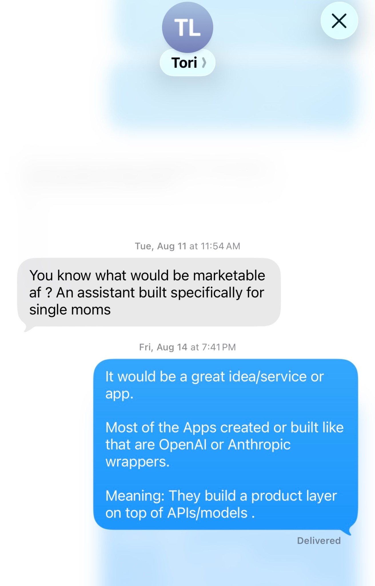
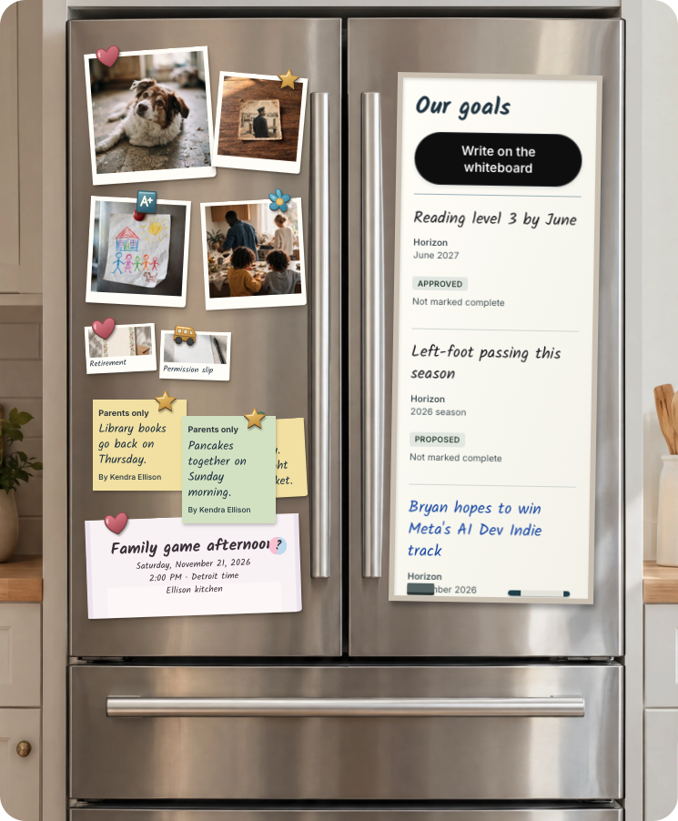
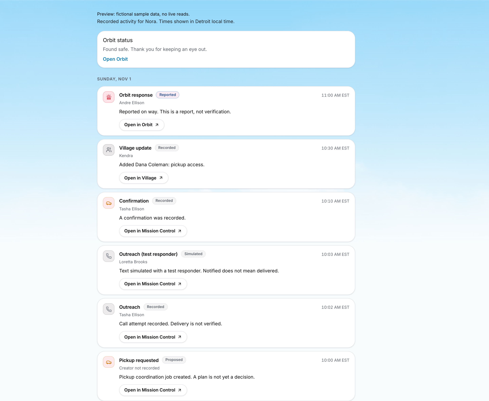

<picture>
  <source media="(prefers-color-scheme: dark)" srcset="docs/assets/readme/hero-dark.svg">
  
</picture>

<p align="center"><strong>FAMILIES ARE NOT ONE HOUSEHOLD. CARE SHOULD NOT BE ONE PERSON'S JOB.</strong></p>
<p align="center">
  <a href="https://fridgegraph.loomz.stream"><strong>Open the live demo ↗</strong></a> &nbsp;·&nbsp;
  <a href="https://youtu.be/aqw40kNL4lA">Watch the three-minute film</a> &nbsp;·&nbsp;
  <a href="#try-the-demo">Judge the seven-step journey</a> &nbsp;·&nbsp;
  <a href="PROVENANCE.md">See the Muse provenance</a> &nbsp;·&nbsp;
  <a href="docs/schema-plan.md">Explore the architecture</a>
</p>

# FridgeGraph

**Families run on information that has no API. FridgeGraph gives the people caring for a child one connected, permissioned village. Rosina helps turn a change in plans into a proposal; a parent decides what happens next.**

> **For judges:** The hosted demo needs no install. Start as Kendra or Demo guide, follow the seven steps on Today, then switch perspectives to see the same village through different permissions. The seven-item checklist includes Rosina actions with explicit confirmation and an invitation-creation journey. Browser voice has a separate Retell transport; see the voice status below. [Launch FridgeGraph](https://fridgegraph.loomz.stream).

**Built from scratch for the Meta Global AI Developer Hackathon, beginning October 26, 2026.** The FridgeGraph application is an original build, not an existing app with AI added for the event. The idea began with Tori telling me how hard single motherhood had become; implementation began with the hackathon. The application code, schemas, workflows and experience were created for this project on top of the external platforms and libraries credited in [PROVENANCE.md](PROVENANCE.md).

## The text that started it

On August 11, my friend Tori was telling me how difficult life had become as a single mother. She was burned out, stressed, and hurting. She wished there were an AI that could help her manage everything she was carrying. In her words: **“You know what would be marketable af? An assistant built specifically for single moms.”**

I could see the distress in her messages, so I picked up the phone. I wanted her to know I cared and wanted to help. **I see the same strain in my own family:** people who love each other, stretched thin by the work of keeping everyday life together.

That conversation gave this project its purpose. A school notice in one place, a calendar in another, a caregiver who can help but lacks the right information—all of it lands on someone who is already exhausted. I wanted to use what I knew about connecting systems to help the people carrying that load.

<a href="docs/assets/origin/tori-message-original.jpg"></a>

*Click the smaller preview to read the full original conversation, including my reply. The image is uncropped and unretouched. The app's families and children are fictional.*

I brought years of enterprise infrastructure experience to a problem I could see in my own circle. At work, we connect distributed services, route requests, preserve ownership, enforce permissions, and record what happened. At home, an exhausted parent often performs all of those jobs from memory.

**The creative leap was to reverse-engineer those enterprise patterns for the modern, fragmented family.** A school knows one part of a child’s day. A grandparent knows another. Co-parents, sitters, coaches, and bus drivers each hold information somebody else needs. The parent becomes the human router between disconnected systems, phones, and households.

My engineering question became: **How do I turn people’s contributions into resource-driven endpoints, so the right person or co-pilot can request the information they need, when they need it?** Each person becomes a permissioned participant in the graph: a source of facts, an owner of decisions, and someone who can respond. Rosina helps carry the coordination; people retain their authority. **The shared fridge is the metaphor; the living village is the system.**

This begins with single mothers, but it is not limited to one family shape. A child may have co-parents in separate homes, a grandparent raising a grandchild, a sitter with narrow access, a teacher reporting a change, or several trusted adults sharing care. FridgeGraph models the relationships and permissions around the child instead of assuming every household has the same structure.

## From human routers to one living graph

A school, a parent, and a caregiver each hold a piece of a child's day. Today, the parent often becomes the **human router**, carrying updates between them. FridgeGraph turns those separate contributions into connected, permissioned records. People are the sources and decision-makers; the seven domain services are the actual API endpoints.

**Rosina is the co-pilot at the center:** she receives the request, gathers the facts the caller may see, explains an option, and brings it back for a decision. **Apollo GraphQL** provides the graph infrastructure: **Apollo Federation** composes domain schemas into a supergraph, and **Apollo Router** plans the calls across those domains. **Apollo GraphOS** is the graph platform used in the documented connected-router setup; the local Rover composition path is also supported. Each resolver and the database enforce access.

<a href="docs/assets/readme/schedule-workflow.svg"></a>

*The animation is an architectural illustration, with motion disabled when reduced motion is requested. The example is a rehearsal moving from 4 PM to 5 PM. It shows two Rosina routes: Muse Spark's grounded reasoning through authorized tools, and the deterministic parser used for exact calendar commands through direct GraphQL. It does not credit the model with a parser-only turn.*

**Confirmation is the turning point.** A proposal does not change the calendar. When the parent confirms, the authorized mutation saves the event, retry receipt, and village activity together. The UI refreshes its data and other authorized perspectives can read the same saved event. On the pickup branch, the corresponding saved job is visible in Rosina, Today, and Mission Control. Neither path implies automatic synchronization with external calendars.

**The outreach branch belongs in the picture too.** GoHighLevel (GHL) provides contact and communication integration; n8n handles the documented workflow and callback paths. The newer SMS transport calls GHL directly, so n8n is not drawn as a mandatory hop for every message. SMS and calls are connected and working, with A2P registration covered, as confirmed by Bryan. Live SMS sending can be enabled with a switch; it is deliberately kept off during testing to avoid messaging the real contacts connected to the system. [Workflow and evidence boundaries](docs/readme-workflow.md#outreach-and-human-responses) explain the distinction.

[How this illustration maps to code](docs/readme-workflow.md) · [Calendar confirmation](web/src/features/rosina/CalendarChangeCard.tsx) · [Atomic write and retry receipt](supabase/migrations/0104_calendar_confirmed_writes.sql)

## A glimpse inside the village

<p align="center"><a href="docs/assets/readme/fridge-current.png"></a></p>

**Every family has its own story. The fridge is where the chapters stick.**

One familiar door for the people, plans, and little moments that bring your village together.

*Current Fridge screen supplied by Bryan, presented with rounded corners. Click to see the unaltered original. Proposed and approved goals are distinct from completed outcomes.*

<table>
  <tr>
    <td width="42%" align="center"><a href="docs/assets/readme/nora-current.png"></a><br><strong>Meet Nora Ellison.</strong><br>A child at the center of a whole village of care.</td>
    <td width="58%"><a href="web/evidence/design/run-appsky-after/activity-cards-desktop.png"></a><br><strong>Activity</strong> · A record of who did what, with simulated outreach labeled as such.</td>
  </tr>
</table>

**One child. Many people who care. One place to coordinate.** Nora's parents, grandmother, sitter, and trusted village each see the information their role permits. When a check-in is missing, Orbit gives her parent one place to review the audience, prepare an alert, and bring the village together.

*Nora's portrait above is the current image supplied for this presentation, reproduced without alteration. The Activity image is a source-controlled design capture. Historical screenshots remain in the evidence folders and may show retired portraits; they are not the current visual reference. The [hosted app](https://fridgegraph.loomz.stream) is the source for what judges can click now. The [notice-to-confirm browser receipt](web/evidence/notice-plan/live-2026-11-02/sample-a-result-desktop.png) records the earlier pickup-request test.*

## One change, visible across the village

| Before | With FridgeGraph | What the judge can check |
| --- | --- | --- |
| A school notice conflicts with pickup; the parent must notice and coordinate it manually. | Rosina reads the sample notice, identifies the conflict against the recorded schedule, and prepares a pickup request. The parent reviews and confirms. | The same recorded job ID appears in Rosina, Today, and Mission Control. A created request is **not** a completed pickup. [Notice path](https://github.com/Pettybytes/fridgegraph/pull/282). |
| A calendar change lives in one conversation or one person's head. | A confirmed Rosina calendar action is stored and audited. | Reload Calendar; check Activity for the add or cancellation. [Cancel repair](https://github.com/Pettybytes/fridgegraph/pull/285). |
| Different caregivers see too much, too little, or conflicting information. | Apollo GraphQL joins seven domains for the signed-in person while server and database policies limit access. | Switch perspective: a parent, caregiver, and Demo guide do not get the same actions or facts. [Cross-family repair](https://github.com/Pettybytes/fridgegraph/pull/269). |
| When a child cannot be found, a parent must individually contact their trusted people. | **Orbit Alert** offers one parent-controlled door to the child's permitted village: description, audience, responses, and an explicit Found safe closure. | Preview the audience and refusal of an incomplete Send. Live SMS is deliberately switched off during testing to protect connected real contacts; this preview does not assert a new delivery test. [Orbit states](docs/evidence/60-orbit-redesign.md). |

Rosina is a co-pilot, not an unchecked dispatcher. A caregiver's “I'm on my way” reports intent; it does not prove a child has been collected. A parent confirmation creates a record; it does not turn a request into a completed outcome. Activity retains the provenance of what changed, who acted, and when.

## Try the demo

Open [fridgegraph.loomz.stream](https://fridgegraph.loomz.stream) in a browser. **No local install is required to judge the hosted app.** Choose the Demo guide or Kendra, then follow the seven steps on Today:

1. Open **Ask Rosina** (chat button, bottom right), then select **Add a notice** just above the message box. Review the school notice, confirm a pickup request, and follow its job ID to Mission Control.
2. Ask Rosina by **text** to add a calendar event; confirm, reload Calendar, and inspect Activity.
3. Ask a grounded family question; switch to another perspective to see access boundaries.
4. Review Orbit's audience and the Prepare screen. Do not send a real alert as a casual smoke test.
5. Explore the Village map and route estimates through different permitted perspectives.
6. Inspect Living Village from a caregiver or read-only Demo guide perspective.
7. As **Kendra**, open **Invitations** in the left menu. Describe the art, fill in the details and wording, then **Generate**. Optionally add a reference photo or ask for a revision, then **Download** the card.

The guide is a fictional showcase. Its seven-item checklist extends the [original six-step guide](https://github.com/Pettybytes/fridgegraph/pull/286) with Invitations. Bryan supplied the deployment/browser-check report for the updated guide; this documentation change does not independently repeat those live checks or claim that every outbound provider is live. [Judge-path smoke instructions](web/e2e/judge-path.README.md) are available for maintainers.

## What Muse does

| Model or system | Role and evidence boundary |
| --- | --- |
| **Meta Muse Spark 1.3** | Rosina's grounded text conversation and action preparation, including reading a school notice against authorized family facts. The parent still confirms consequential actions. [Notice evidence](docs/evidence/67-rosina-notice-briefing-live.md). |
| **Meta Muse Voice Transcribe 1.0** | Transcribes spoken input in the original sequential voice path; the newer Retell browser voice transport is separate. [Corrected backend round trip](docs/evidence/61b-voice-backend-corrected.md). |
| **Meta Muse Image 1.0** | Generates invitation art and supports reference-image edits and revisions. [Creative workflow](https://github.com/Pettybytes/fridgegraph/pull/199) is merged; [polished card and provider receipt](https://github.com/Pettybytes/fridgegraph/pull/289) document the invitation path. Invitations is now checklist item 7, following the deployment/browser-check report supplied by Bryan. Event details are rendered as readable card text rather than trusting an image model to spell names and dates. |
| **Meta Muse Wonder** | Assisted development: diagnosis, code review, and verification of map, transport, authorization, and demo repairs. It is a development collaborator, not a runtime decision-maker or a substitute for a public-site receipt. See [map repair](https://github.com/Pettybytes/fridgegraph/pull/273) and [handoff trail](https://github.com/Pettybytes/fridgegraph/pull/78). |
| **Apollo GraphQL / GraphOS + MCP + Supabase** | The authorized data and action path. Seven domain subgraphs compose through Apollo Router; caller identity flows through MCP to resolvers; Supabase stores records and applies row-level permissions. Model text does not override database policy. |

**What voice taught us:** the original sequential speech → transcript → Muse response → ElevenLabs audio path measured about **6.9 seconds median and 11.2 seconds p95** in an 18-turn public-site diagnosis. That was too slow for effortless conversation. The Retell v3 browser-call transport subsequently merged in [PR #293](https://github.com/Pettybytes/fridgegraph/pull/293). Bryan reports that the public voice path worked, including a parent-confirmed calendar creation. This documentation update did not repeat that live call. The hybrid design uses Retell’s managed conversation for grounded schedule reads and Muse Spark for calendar-create proposals; the parent still confirms the write. These historical timings are not benchmarks for the newer path, and voice support for updates/deletes is not implied.

## Architecture and guardrails

| Layer | Responsibility |
| --- | --- |
| **Village** | People, households, relationships, care plans, and groups. |
| **Access** | Grants, policies, approvers, and parenting schedules. |
| **Coordination** | Pickup jobs, attempts, confirmations, and Orbit state. |
| **Schedule** | Calendar events and care schedule. |
| **School** | Reports and permission slips. |
| **Transport** | Vehicles, bus context, and route-related data. |
| **Activities** | Practices and group events. |

Apollo Federation composes the seven domain schemas; Apollo Router executes requests against that supergraph. Apollo GraphOS provides the documented connected graph platform, while Rover also supports local composition. [GraphOS-connected router evidence](docs/evidence/15-graphos-jwt-router.md) records that setup without implying every demo request requires GraphOS. Rosina operates as the signed-in person through authorized tools; mutations and database functions also enforce their own boundaries. The web app uses React, TypeScript, Vite and Apollo Client. Supabase Postgres holds the fictional demo records. ElevenLabs gives Rosina speech; n8n and GoHighLevel (GHL) connect communication workflows and human replies. Bryan confirms that SMS and calls work and A2P registration is covered. Live SMS sending is switch-controlled and intentionally kept off during judge/testing sessions to protect the real contacts connected to the system. In-app voice and outbound calls to contacts are separate paths. Map travel estimates are labeled estimates, not ride bookings or real-time Uber/Lyft quotes.

Orbit is a **private coordination tool for a trusted village**, not an official emergency alert or replacement for emergency services. Only a parent can activate it; recipients see only information their role permits, and sensitive details are redacted after closure. The app does not track a child's location.

## Run the code yourself

The hosted demo above is the quickest evaluation path. For a source review, start with a clean clone and use the checked-in lockfiles:

```bash
git clone https://github.com/Pettybytes/fridgegraph.git
cd fridgegraph
npm ci
npm --prefix web ci
npm run typecheck
npm run check
npm --prefix web run build
```

These are **source and build checks**, not a one-command public deployment. Running the full graph locally also requires your own Supabase project, the runtime variables named in `.env.example` and `web/.env.example`, Apollo Router/Rover and the project's setup/migrations. Never commit credential values. The [local topology](docs/apollo-notes.md), [schema ownership](docs/schema-plan.md), and [judge smoke test](web/e2e/judge-path.README.md) are the next references. Do not run `db:reset` against a shared or production database.

## Evidence, limits, and provenance

- [Hackathon provenance and model roles](PROVENANCE.md)
- [Recorded checks](docs/evidence/) and [browser evidence](web/evidence/)
- [The school notice mouse-confirm repair and same-ID assertion](https://github.com/Pettybytes/fridgegraph/pull/282)
- [Original six-step perspective checklist](https://github.com/Pettybytes/fridgegraph/pull/286)
- [Calendar cancel source fix](https://github.com/Pettybytes/fridgegraph/pull/285)
- [Orbit parent activation and post-close redaction](docs/evidence/60-orbit-redesign.md)

This repository records implementation and tests, but a merge does not prove deployment and a green CI check does not prove a live provider response. The source proofs, public-site checks, and outstanding gates are deliberately kept distinct. FridgeGraph was built for this hackathon with fictional demo families; Tori's text is the real origin of the idea.

## The frontier: a co-pilot that grows with its village

FridgeGraph’s future is a relationship-aware co-pilot: an agent that can build recognizable, memorable continuity with the people it supports. With permission, Rosina could remember preferences, learn from corrected plans and confirmed outcomes, and understand how a family’s routines and relationships evolve—without asking everyone to explain their world again every day.

The stack behind FridgeGraph provides a starting point: connected context, scoped access, explicit decisions, and a history of what actually happened. The next research step is making that context useful over time: separating a remembered fact from an inference, letting people inspect and correct memories, and respecting revoked access. This is a future direction, not a claim that today’s model continually retrains itself or already has durable personal relationships.

**The dream is to make this useful for families who need support most.** Single parents carrying too much. Grandparents raising grandchildren. Co-parents coordinating across homes. Families whose village exists but struggles to stay connected.

Technology can pull people into separate screens. I want to use it to bring them closer: fewer missed handoffs, less repeated explaining, and more room to show up for one another. The ambition is a co-pilot that strengthens human relationships and gives families more time together.

**From fragmented information and isolated responsibility → a connected village and shared care.**
